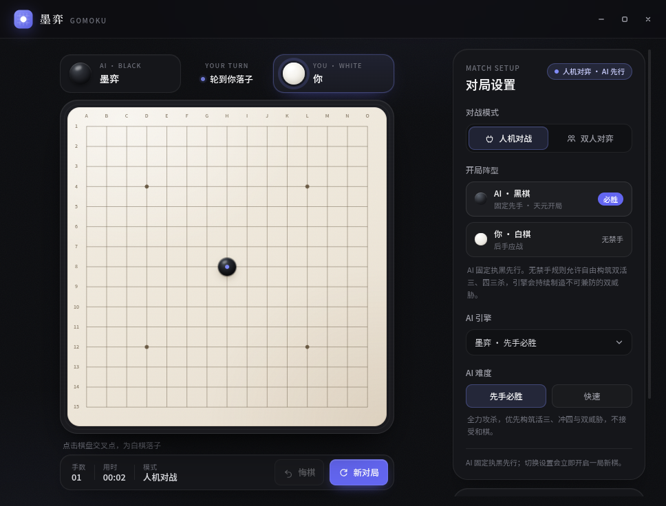

# 墨弈 · 五子棋

一款以 **Electron + Vue 3 + TypeScript** 构建的现代桌面五子棋。墨色、木纹与暖金构成克制的东方棋局氛围；支持人机对战、双人同屏对弈，以及可插拔的 AI 引擎。



## 功能

- **人机对战（AI 固定先手）**：AI 永远执黑先行，你执白应战。内置「先手必胜」引擎：天元开局，连续冲四算杀叠加深度攻杀，执行无禁手规则下的先手优势。
- **双人对弈**：同一设备轮流落子，黑棋先行。
- **完整棋局**：五子连珠判定、和棋、落子预览、最后一步标记、获胜连线动画。
- **对局操作**：悔棋、重新开局、实时手数与计时。
- **可扩展 AI**：统一的 `AIEngine` 接口与主进程注册表；新增引擎会自动出现在界面中。
- **现代桌面体验**：无边框窗口与自绘窗口控件、响应式双栏布局、原生字体资源、离线可用。
- **安全边界**：`contextIsolation`、沙箱化 preload、最小化 IPC 暴露面、CSP。

## 技术栈

| 层次 | 方案 |
| --- | --- |
| 桌面容器 | Electron 45 |
| 渲染层 | Vue 3.5 + TypeScript |
| 构建 | electron-vite 6 / Vite 8 |
| 测试 | Vitest 5 |
| 打包 | electron-builder 26 |
| 状态与规则 | 原生 Vue Composition API + 共享 TypeScript 棋规模块 |

## 快速开始

要求 Node.js ≥ 22.12，推荐使用 pnpm 12。

```bash
pnpm install
pnpm dev
```

> Electron 45 的运行时会在首次启动时按需下载。如果启动前希望提前准备，可执行
> `pnpm exec electron --version`。

### 本地开发

```bash
pnpm dev          # 启动 Electron + Vite 开发服务器
pnpm test         # 运行规则与 AI 单元测试
pnpm typecheck    # 校验主进程与渲染进程类型
pnpm build        # 类型检查并生成 out/
pnpm preview      # 用 Electron 预览生产构建
```

### 打包

```bash
pnpm dist         # 生成当前平台的可运行目录，输出到 release/
pnpm dist:linux   # 在 Linux 上生成 AppImage
pnpm dist:win     # 在 Windows 上生成 NSIS 安装包
```

`electron-builder.yml` 中已经配置 Windows NSIS、macOS DMG 与 Linux AppImage 目标；CI 产物名统一为 ASCII：
`moyi-gomoku-<version>-<arch>-setup.exe` 与 `moyi-gomoku-<version>-<arch>.AppImage`。

### GitHub Actions 自动构建与发布

仓库内置 [`.github/workflows/release.yml`](.github/workflows/release.yml)。推送形如 `v1.0.0` 的 tag 后，GitHub 会：

1. 校验 tag 与 `package.json` 的 `version` 一致，并运行测试；
2. 在 `ubuntu-latest` 构建 Linux AppImage，在 `windows-latest` 构建 Windows NSIS 安装包；
3. 创建（或更新）GitHub Release，并把两个安装包作为 release assets 上传。

```bash
# 发布前先确认 package.json 的 version 与 tag 一致
git tag v1.0.0
git push origin main
git push origin v1.0.0
```

注意事项：

- **tag 必须指向包含该 workflow 的提交。** 如果 tag 已经指向旧提交（例如本地已有的 `v1.0.0`），提交本 workflow 后需要把 tag 移到最新提交（`git tag -f v1.0.0`）再推送，或先升级 `package.json` 版本并发布新 tag；否则 GitHub 找不到 workflow，不会触发。
- tag 去掉 `v` 后必须与 `package.json` 的 `version` 完全相同（workflow 会校验）。
- 仓库 Settings → Actions → General 的 Workflow permissions 需要允许 **Read and write**，`GITHUB_TOKEN` 才有权限创建 Release。公开仓库通常默认即可。
- 产物未签名：Windows SmartScreen 可能提示未知发布者；Linux AppImage 需要 `chmod +x` 后运行。macOS 不在该工作流中。
- 当前矩阵构建 x64；如需 arm64，可在 workflow 的 matrix 中增加对应 runner 与 `--arm64` 参数。

## 目录结构

```text
src/
├── main/                 # Electron 主进程
│   ├── index.ts          # 窗口、生命周期、窗口控制 IPC
│   └── ai/
│       ├── registry.ts   # AI 引擎注册表与默认注册
│       ├── ipc.ts        # AI 请求校验、超时与 IPC handler
│       └── engines/
│           ├── classic.ts      # 参考/测试用启发式引擎
│           └── first-player/   # 先手必胜引擎（VCF + α-β）
├── preload/              # 沙箱 preload，仅暴露类型化 bridge
│   └── index.ts
├── shared/               # 主进程与渲染进程共享的纯 TypeScript
│   ├── ai.ts             # AIEngine / AIEngineRegistry 公共契约
│   ├── ipc.ts            # IPC 通道与桌面 API 类型
│   └── game/             # 棋盘类型与棋规
└── renderer/             # Vue 3 渲染进程
    ├── index.html
    └── src/
        ├── App.vue
        ├── components/   # 标题栏、棋盘、设置、结果层
        ├── composables/  # 对局状态与 AI 调度
        └── styles/
tests/                    # 棋规与 AI 单元测试
docs/                     # AI 扩展指南与界面截图
build/                    # 应用图标等打包资源
.github/workflows/        # GitHub Actions：tag 触发的 Windows/Linux 打包与 Release
```

## 架构

```text
┌────────────────────────────────────────────────────┐
│ Renderer (Vue 3)                                   │
│  GameBoard → useGomokuGame → window.gomoku.ai      │
└───────────────────────┬────────────────────────────┘
                        │ contextBridge / typed IPC
┌───────────────────────▼────────────────────────────┐
│ Preload (sandbox, contextIsolation)                │
└───────────────────────┬────────────────────────────┘
                        │ ipcRenderer.invoke
┌───────────────────────▼────────────────────────────┐
│ Main process                                       │
│  AI IPC handler → DefaultAIEngineRegistry → engine │
│  Game rules shared with the renderer               │
└────────────────────────────────────────────────────┘
```

棋规和 AI 请求 DTO 放在 `src/shared/`，避免主进程与渲染层出现两套规则。AI 计算在主进程执行，渲染层只通过类型化 IPC 请求落点，界面不必了解任何引擎实现。

## AI 接口与扩展

公共契约定义在 [`src/shared/ai.ts`](src/shared/ai.ts)，核心只有一个方法：

```ts
export interface AIEngine {
  readonly info: AIEngineInfo
  chooseMove(
    request: Readonly<AIMoveRequest>,
    signal?: AbortSignal
  ): Promise<AIMove>
}
```

新增引擎只需实现该接口，并在
[`src/main/ai/registry.ts`](src/main/ai/registry.ts) 中注册。引擎的
`name`、`description`、`version` 与 `levels` 会通过 IPC 自动展示在设置面板中，**无需修改任何 Vue 组件**。

完整教程、示例代码与设计约定见：

- **[AI 引擎扩展指南](docs/AI_ENGINE_GUIDE.md)**
- **[先手必胜引擎设计](docs/FIRST_PLAYER_ENGINE.md)**
- 默认引擎：[`first-player/`](src/main/ai/engines/first-player/)
- 参考引擎：[`classic.ts`](src/main/ai/engines/classic.ts)（不注册到人机模式）

当前默认且唯一注册到人机模式的引擎是 [`first-player-win`](src/main/ai/engines/first-player/engine.ts)：固定 AI 执黑先行，天元开局后先处理即时成五与必败点，再用 **VCF（连续冲四）强制搜索**寻找可证明的杀棋，最后以迭代加深 α-β、威胁延伸和棋型评估构筑双活三 / 四三杀。`classic.ts` 仍保留为扩展指南中的参考与测试引擎，但不会出现在人机引擎选择中。

## 规则约定

- 15 × 15 棋盘，黑棋先行；**人机模式固定 AI 执黑先行，玩家执白后行**。
- 横、竖、斜任意方向连续五子或更多即获胜（长连同样算胜）。
- 无禁手、无三三 / 四四限制，因此先手可以自由构筑双活三、四四等复合杀型。
- 棋盘填满且没有连线时判和。
- 人机模式下，悔棋会撤销你最近的一手以及其后的 AI 应手；AI 思考中悔棋会取消本次思考并退回你的落子前。

## 测试

```bash
pnpm test
```

当前测试覆盖棋规方向判定、边界与和棋、非法落子、AI 立即取胜、封堵、VCF 先手连攻、固定先手对局（含白棋首手贴近天元与远离天元）、合法落点、不可变性、AbortSignal、难度与满盘异常、引擎注册表等。开发期还在 35 个白棋首手对称轨道上做了压力测试：默认 2 秒预算对 300 ms 强防守时，先前被反杀的困难首手全部黑胜；较低预算下多数轨道黑胜。

## 字体与许可

应用离线内置了按需裁剪的 **Noto Sans SC / Noto Serif SC** 字体子集（SIL Open Font License 1.1），以获得更稳定的中文排版。许可与版权声明见
[`THIRD_PARTY_NOTICES.md`](THIRD_PARTY_NOTICES.md)，原始许可文本保存在字体资源目录中。

项目自身使用 [MIT License](LICENSE)。

## 已知边界

- 五子棋先手必胜已有计算机证明，但完整证明树（约十余万局面）远超应用内置搜索规模。本引擎在无禁手规则下执行先手强攻：VCF 分支给出可证明的强制胜，非杀型局面由深度搜索与棋型评估驱动。默认 2 秒预算下，35 个首手轨道中被重点复核的困难局面均黑胜；较低预算下仍有少数轨道可能被强防守反杀。它不携带完整数学证明树。
- AI 搜索在主进程内同步完成，默认单步约 2 秒；思考期间窗口控制类 IPC 可能短暂无响应。
- 暂未实现棋谱持久化、联网对战、禁手规则与音效。
- 打包未签名；发布到公共渠道前需要补充各平台的签名与公证配置。
